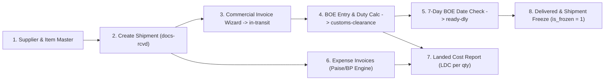
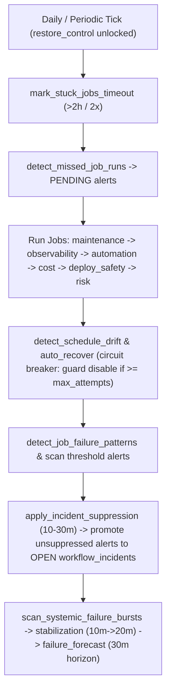

# ERP Workflow Documentation – Import Manager

> **Purpose:** End-to-end operational, financial, and platform workflows reproduced in **Import Manager Next Generation**.

---

## 1. Core Import Operations Lifecycle (Supplier -> Landed Cost)



### Workflow Steps
1. **Master Data Setup:** User creates/imports `Supplier` and `Item Master` items (with HSN code, baseline BCD/SWS/IGST %, currency, unit, default price). Missing dropdown values can be added directly into the 13 lookup tables.
2. **Shipment Registration (`docs-rcvd`):** Created manually or via CSV/Excel import (auto-detecting `\t`/`;`/`,` delimiters and Excel serial dates). Initial status is `docs-rcvd`.
3. **Commercial Invoice Wizard (3 Steps):**
   - **Step 1 (Header):** Bind to an active, non-terminal, non-frozen shipment; pick invoice no & date (draft auto-saved up to 20 drafts / 30d TTL).
   - **Step 2 (Lines):** Paste tabular lines (Formats A/B) or select items from Item Master; non-blocking alert shown if `unitPrice` differs from Item Master baseline.
   - **Step 3 (Review & Save):**
     - **Save Draft:** Persists invoice even if line sum differs from `shipment.invoiceValue`.
     - **Finalize Invoice:** Requires exact integer-cent match (`sum(lineTotals) == shipment.invoiceValue`). On success, automatically transitions non-delivered shipment to `in-transit`.
     - **Finalize Shipment:** Calls `freeze_shipment` setting `is_frozen = 1`.
4. **Bill of Entry (BOE) & Customs Duty Calculation:**
   - **Registry:** Operator records customs BOE (`be_number`, `be_date`, `challan_number`, `duty_paid`, attachments).
   - **Duty Entry:** Select supplier & shipment -> system loads invoice lines & applies `CIF` zero-locks (`freight=0, exw=0, insurance=0`) if `incoterm == 'CIF'`. Operator sets `exchangeRate`, `freightCost` (INR), `exwCost` (INR), `insuranceRate` (default `0.015%`), `interest` (INR), and optionally uploads a Rate Override CSV (`partNo, calculationMethod, boeBcdRate, boeSwsRate, boeIgstRate`).
   - **Validation & Save:** Save blocked if any line has `boeBcdRate > actualBcdRate` (`>0`) or if linked BOE `dutyPaid != customsDutyTotal` (rounded to 2 dp). Writes crash-recovery record (`boe_write_recovery` pending -> completed), saves `boe_calculations` + `boe_items`, and transitions shipment status to `customs-clearance` (or `ready-dly` when `be_date + 7 days <= today`).
5. **Import Expense Recording (Paise / Basis Points):**
   - Operator selects active shipment & Service Provider -> adds multiple expense lines (pre-tax INR -> paise, GST/TDS % -> basis points) -> optionally runs **Combine Duplicates** -> calls **Preview** (`TaxCalculator` integer division) -> submits with UUID `idempotency_key`.
   - Or bulk imports `.csv`/`.xlsx` via the 11-column template (matched strictly by `Expense Type` and `Service Provider` names).
6. **Landed Cost & Expense Reporting:**
   - Query `report_view`: sums basic expenses (`SUM(amount)`) per shipment, prorates across BOE items by `assessable_value / shipment_total_av`, and computes `LDC per qty = (AV + BCD + SWS + Allocated Basic Expenses) / Qty` (excluding IGST).
   - Export Landed Cost CSV / print PDF, BOE 3-sheet Excel / 3-part ICEGATE PDF, and 5-view Expense Reports (CSV / Excel / HTML).

---

## 2. Authentication, Lockout & Emergency Recovery Flow

```mermaid
sequenceDiagram
  participant U as Operator
  participant UI as Login UI
  participant Sec as Go SecurityService
  participant DB as SQLCipher DB
  U->>UI: Enter username + password
  UI->>Sec: Authenticate(user, pass, rememberMe)
  Sec->>DB: Check auth_lockout_state
  alt Locked (now < locked_until)
    Sec-->>UI: Reject (Lockout active until timestamp)
  else Unlocked
    Sec->>DB: Load user_roles hash
    alt Argon2id / bcrypt verify OK
      Sec->>DB: Clear lockout window, issue session (12h / 30d), audit_log
      Sec-->>UI: Return Session + 25 RBAC Permissions
    else Invalid Password
      Sec->>DB: Insert auth_failed_attempts; if count>=5 in 15m -> set locked_until (+30m)
      Sec-->>UI: Reject (Remaining attempts / Lockout)
    end
  end
```

- **Emergency Recovery (`--recovery` or `IMPORT_MANAGER_RECOVERY=1`):**
  1. App starts with `recovery_mode = true`.
  2. Recovery UI exposes bounded administrative reset actions: `recovery_clear_lockout`, `recovery_reset_security_policy`, `recovery_set_admin_password` (note: encrypted DB still requires valid SQLCipher key — never bypasses encryption).

---

## 3. Backup, Restore & Google Drive Sync Workflow

1. **Local Backup Creation:**
   - Read/prompt `backup_encryption_password` from Windows Credential Manager (`service="ImportManager"`).
   - Flush WAL (`PRAGMA wal_checkpoint(TRUNCATE)`) & create consistent snapshot via SQLite Online Backup API.
   - Encrypt snapshot using `IMBK2` (`PBKDF2-HMAC-SHA256` 600,000 iters -> AES-256-GCM) and write companion `.sha256` checksum sidecar + record row in `backups`.
2. **Google Drive Sync:**
   - Authorize via browser using `http://127.0.0.1:8765/` loopback listener -> store `google_drive_refresh_token` & email in Credential Manager.
   - Upload `.imbk` + `.sha256` into `ImportManagerBackups` Drive folder -> store `gdrive:<fileId>` URI -> prune remote backups exceeding retention cap (max `30`).
3. **Crash-Safe Restore Workflow:**
   - Verify `.sha256` sidecar & decrypt `IMBK2`/`IMBK1` header (dry-run simulation optional).
   - Activate global restore barrier (`restore_control.set_restoring(true)`), pausing background scheduler ticks and mutating RPCs.
   - Automatically take a pre-restore safety backup of the current live database.
   - Copy/swap restored database & run `PRAGMA integrity_check` + migration version validation -> release barrier -> log restore audit event.

---

## 4. Soft Delete, Bulk Operations & Recycle Bin Flow

1. **Soft Delete:** Deleting rows in any of the 11 core tables sets `deleted_at` and `deleted_by` instead of physical removal.
2. **Bulk Operations + Undo:** Multi-row bulk delete processes in chunks of `500` (warning `>50,000`, auto-select-all `>100,000`) and issues a **5-minute undo token** for instant batch reversal.
3. **Recycle Bin Restore:** Restoring a child record (e.g., `invoice`, `expense`, `boe_calculation`) checks whether its parent (`shipment`, `supplier`, `boe_details`) is active. If the parent is soft-deleted or purged, restore aborts with a structured `missing_parent` payload grouped by table and IDs.
4. **Hard Delete (Permanent Purge):** Runs Dependency Reference Scanner (`reference_scan`) across child tables. Blocked with `DEPENDENCY:` if active children exist. If clear, requires PIN verification (subject to lockout) + typing `'DELETE'` when impacted dependency count `> 5,000`.

---

## 5. Exception Workflow, Rule Deployment & Background Operations Lifecycle



- **Exception Case Lifecycle:** `OPEN` -> `IN_PROGRESS` (manual or `AUTO_LOAD_BALANCED` assign) -> `RESOLVED` or `IGNORED`. `RESOLVED`/`IGNORED` cannot return to `OPEN`/`IN_PROGRESS`. Self-heal resets `IN_PROGRESS > 14d` back to `OPEN`.
- **Rule Promotion Pipeline:** Rule Version edited -> staged (`DRAFT -> TESTING -> READY`) -> submitted for approval (`PENDING -> APPROVED`) -> Risk Assessment (`<25 LOW .. >=75 CRITICAL`; blocks `env-prod` on `HIGH`/`CRITICAL` unless `admin` override) -> promoted strictly one environment at a time (`DEV -> TEST -> PROD`) -> optional FNV-1a canary rollout -> `DEPLOYED` (rollback restores previous rule state & logs `rollback_action_log`).
- **Incident Resolution Gate:** An `OPEN` incident requires (1) at least one `RESOLUTION_NOTE` or `MANUAL_INTERVENTION` history row (`>= 10` chars), (2) `root_cause_summary.len() >= 50` chars, and (3) zero new correlated events within the last `10` minutes (unless `skip_correlation_quiet_check` is explicitly passed).
